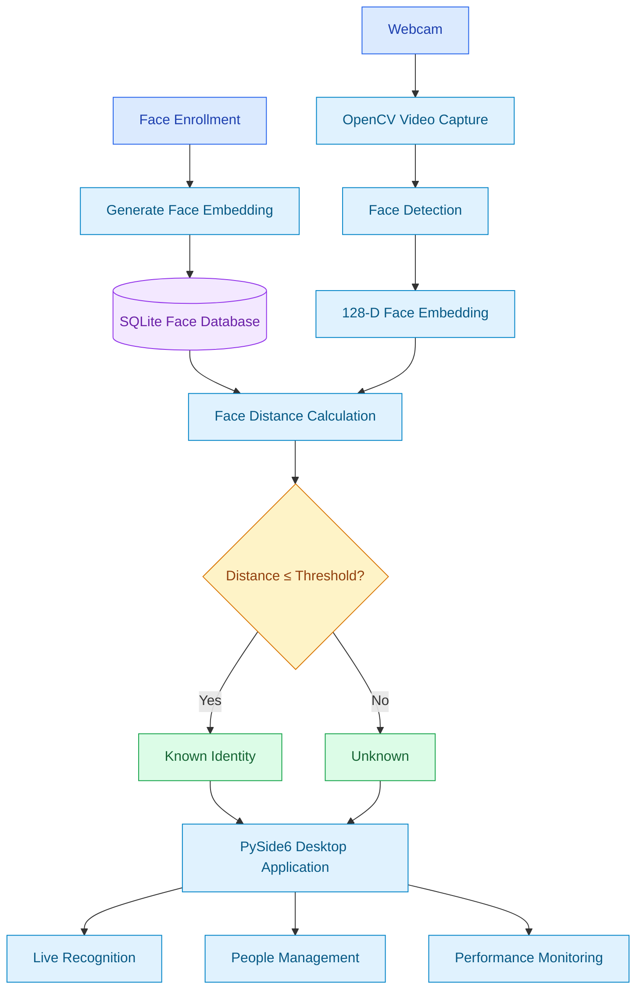

	

# Face Recognition Python

A desktop face recognition application built with **Python, OpenCV, dlib, face_recognition, PySide6, and SQLite**.

The system supports real-time face detection and identification, face enrollment, identity management, and performance evaluation.

It uses pretrained facial recognition models to generate 128-dimensional face embeddings and compare them against registered identities.

## Features

### 1. Real-Time Face Recognition

- Capture live video using OpenCV.
- Detect and recognize faces from webcam frames.
- Extract 128-dimensional facial embeddings.
- Match detected faces against registered identities.
- Label unmatched faces as `Unknown`.
- Support configurable recognition thresholds.
- Run camera processing in a separate PySide6 QThread.

### 2. People Management

- Register new identities directly from the webcam.
- Store facial embeddings and names in SQLite.
- View registered face records.
- Rename and delete registered records.
- Reload recognition data without restarting the application.
- Validate face enrollment to accept images containing exactly one detectable face.

### 3. Performance Monitoring

The live recognition interface displays:

- Display FPS: Number of processed/displayed frames per second.
- Recognition FPS: Number of recognition cycles completed per second.
- AI Latency: Processing time for the latest face detection and recognition cycle.

Recognition is performed periodically rather than on every camera frame to reduce processing overhead.

### 4. Benchmark and Evaluation

An offline evaluation pipeline is provided to measure:

- Identification Accuracy
- False Acceptance Rate (FAR)
- False Rejection Rate (FRR)
- Wrong Identity Rate
- Mean Processing Latency
- P95 Processing Latency

Benchmark results are exported as CSV and JSON files.

### 5. Automated Testing

The project includes 13 unit tests covering:

- Face embedding matching
- Known and unknown identities
- Recognition thresholds
- Invalid embedding inputs
- SQLite insert and load operations
- Identity renaming and deletion
- Database input validation

## Tech Stack

| Category            | Technologies           |
| ------------------- | ---------------------- |
| Language            | Python 3.11            |
| Computer Vision     | OpenCV                 |
| Face Recognition    | face_recognition, dlib |
| Numerical Computing | NumPy                  |
| Desktop GUI         | PySide6                |
| Concurrency         | QThread                |
| Database            | SQLite                 |
| Testing             | pytest                 |
| Reporting           | CSV, JSON              |

## System Architecture


```



```
```


## How It Works

### Face Enrollment

1. Open the desktop application.
2. Start the webcam.
3. Navigate to People Management.
4. Enter a person's name.
5. Capture a frame containing exactly one detectable face.
6. Generate a 128-dimensional facial embedding.
7. Save the name and embedding to SQLite.
8. Reload registered face data.

### Face Recognition

1. OpenCV captures frames from the webcam.
2. The detection module identifies face locations.
3. The recognition model generates face embeddings.
4. Each embedding is compared against stored embeddings using Euclidean distance.
5. The closest match is selected.
6. If the distance is below or equal to the configured threshold, the stored identity is returned.
7. Otherwise, the result is `Unknown`.

The default recognition threshold is `0.50`.

A lower threshold generally applies stricter matching, while a higher threshold allows more permissive matching.

**Note:** The application uses pretrained face recognition models. It does not train a new deep learning model from scratch.

## Project Structure

```text
Face_recognizer/
|
|-- src/
|   |-- main.py
|   |-- camera_worker.py
|   |-- people_manager.py
|   |-- detector.py
|   |-- recognizer.py
|   |-- trainer.py
|   |-- benchmark.py
|   |-- utils.py
|
|-- database/
|   |-- Sqlite.py
|   |-- insert_faces.py
|   |-- load_faces.py
|   |-- __init__.py
|
|-- tests/
|   |-- test_recognizer.py
|   |-- test_database.py
|
|-- data/                  # Local data (Git ignored)
|   |-- face.db
|   |-- Pic/
|   |-- benchmark/
|       |-- known/
|       |-- unknown/
|
|-- reports/               # Generated reports (Git ignored)
|
|-- requirements.txt
|-- .gitignore
|-- README.md
```

The `data/` and `reports/` directories are local and may not exist immediately after cloning the repository.

## Installation (Windows)

### 1. Clone the Repository

```powershell
git clone https://github.com/Minh-Canh33/face-recognition-python.git
cd face-recognition-python
```

### 2. Create a Virtual Environment

Python 3.11 is recommended for the current project environment.

```powershell
py -3.11 -m venv env-face
```

Activate the virtual environment:

```powershell
.\env-face\Scripts\Activate.ps1
```

If PowerShell blocks activation, run:

```powershell
Set-ExecutionPolicy -Scope Process -ExecutionPolicy RemoteSigned
```

Then activate the environment again.

### 3. Install Dependencies

```powershell
python -m pip install --upgrade pip
python -m pip install -r requirements.txt
```

The project has been developed using Windows, Python 3.11, and prebuilt dlib binaries.

Package installation may vary depending on Python version, operating system, and wheel availability.

### 4. Initialize the Database

```powershell
python -m database.Sqlite
```

This creates the SQLite database and required table if they do not already exist.

Default database path:

```text
data/face.db
```

### 5. Run the Application

```powershell
python -m src.main
```

The PySide6 desktop interface will open.

## Using the Application

### Live Recognition

1. Select **Live Recognition**.
2. Click **Start Camera**.
3. Allow the webcam to capture video.
4. View face bounding boxes and recognized names.
5. Monitor Display FPS, Recognition FPS, and AI Latency.
6. Click **Stop Camera** to release the webcam.

### People Management

1. Start the camera.
2. Navigate to **People Management**.
3. Enter the person's name.
4. Click **Register from Camera**.
5. Confirm the successful registration.
6. Use the table to rename or delete registered face records.

Changes are saved to SQLite and can be reloaded into the recognition process without restarting the application.

## Benchmark and Evaluation

### Dataset Structure

Prepare a labeled evaluation dataset:

```text
data/benchmark/
|
|-- known/
|   |-- Person01/
|   |   |-- test1.jpg
|   |   |-- test2.jpg
|   |
|   |-- Person02/
|       |-- test1.jpg
|       |-- test2.jpg
|
|-- unknown/
    |-- stranger1.jpg
    |-- stranger2.jpg
```

Important requirements:

- Folder names under `known/` must match registered identity names in SQLite.
- Images under `unknown/` must belong to identities not registered in SQLite.
- Evaluation images must not duplicate enrollment images.
- Each evaluation image should contain exactly one detectable face.
- Use images collected with appropriate consent.

### Run Benchmark

Default threshold:

```powershell
python -m src.benchmark --threshold 0.50
```

Compare different thresholds:

```powershell
python -m src.benchmark --threshold 0.40
python -m src.benchmark --threshold 0.50
python -m src.benchmark --threshold 0.60
```

Reports are generated in the `reports/` directory.

Output formats:

- Detailed prediction results: CSV
- Benchmark summary: CSV
- Benchmark summary: JSON

## Experimental Results

The following results were obtained from a small local evaluation performed on November 11, 2026.

### Offline Recognition Benchmark

| Metric                  | Result     |
| ----------------------- | ---------- |
| Recognition Threshold   | 0.50       |
| Registered Identities   | 4          |
| Gallery Embeddings      | 4          |
| Total Evaluation Images | 5          |
| Valid Images            | 5          |
| Known Identity Images   | 4          |
| Unknown Identity Images | 1          |
| Correct Predictions     | 5/5        |
| Accuracy                | 100%       |
| False Acceptance Rate   | 0%         |
| False Rejection Rate    | 0%         |
| Wrong Identity Rate     | 0%         |
| Mean Processing Latency | 657.314 ms |
| P95 Processing Latency  | 879.851 ms |

**Important:** These results are from a preliminary five-image evaluation, not a large-scale recognition benchmark. The 100% accuracy applies only to this small test set and does not represent the expected accuracy across unseen identities, lighting conditions, camera devices, or environments.

The latency measurement includes image loading, face detection, face encoding, and embedding matching. It is not a model-only inference benchmark.

### Unit Test Results

```text
Platform: Windows
Python: 3.11.9
pytest: 9.2.0

13 tests collected
13 tests passed
```

Run the tests:

```powershell
python -m pytest tests/ -v
```

Database unit tests use temporary SQLite files and do not modify the actual face database.

## Known Limitations

- Recognition quality is affected by lighting, pose, occlusion, and image quality.
- Face matching thresholds require evaluation on a larger independent dataset.
- The current evaluation dataset is too small for reliable accuracy estimates.
- CPU-based processing can introduce noticeable recognition latency.
- The application uses pretrained models rather than training its own neural network.
- The current SQLite structure stores individual face records, not a fully normalized person-to-multiple-samples relationship.
- The application is an educational project and is not designed for security-critical biometric authentication.

## Privacy and Security

Facial images and embeddings are sensitive biometric information.

- Local facial databases and raw images are excluded from Git tracking.
- Do not commit personal photographs or biometric databases.
- Obtain consent before collecting or processing facial images.
- Delete registered data when it is no longer required.
- Avoid using this prototype as the sole basis for access control or identity verification.

## Future Improvements

- Expand the independent benchmark dataset.
- Improve handling of different lighting conditions and face angles.
- Add multi-sample enrollment for each registered identity.
- Improve recognition performance on CPU.
- Add clearer performance visualizations and benchmark comparison tools.
- Improve application packaging and Windows installation instructions.

## Author

**Minh Canh**

GitHub: [Minh-Canh33](https://github.com/Minh-Canh33)

Project Repository: [Face Recognition Python](https://github.com/Minh-Canh33/face-recognition-python)

---

If you find this project useful, consider giving it a star on GitHub.
